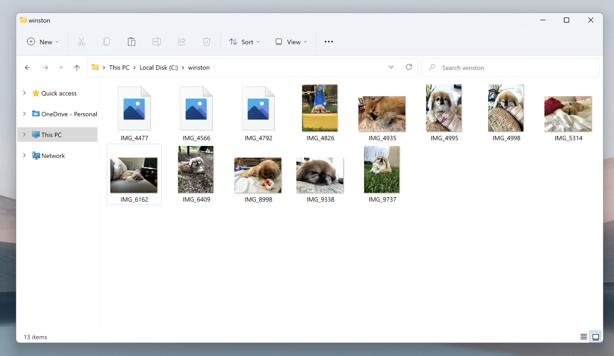
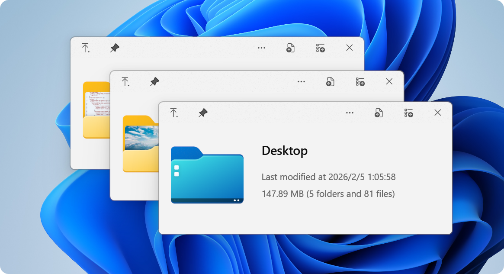

# QuickLook for Spacebar Previews and Office Documents

QuickLook brings a preview window to files selected in Windows File Explorer.
QuickLook Office Plugin searches commonly lead to OfficeViewer, the separate extension for Word, Excel, and PowerPoint documents.
Choose a QuickLook Plugin according to the formats it handles and the dependencies it requires.

[](https://quicklook-office-plugin.github.io/QuickLook-Plugin/)

## Use Cases

A quicklook file viewer workflow helps identify a file before opening its editing application.
It is useful when several similarly named documents sit beside images, PDFs, and downloaded archives.
The selected file stays the starting point for each preview.

- Compare the visible contents of document revisions.
- Check an image before attaching it to a message.
- Inspect a text file while organizing a project folder.
- Review a presentation without starting a separate editing session.

Preview support depends on the active viewer.
A file extension appearing in an application's general format list does not establish that every optional plugin is present.
For Office documents, confirm the OfficeViewer extension separately from the QuickLook host.



The native application also accepts a file path as a command-line argument.
This PowerShell example targets an existing document using an example portable application location.

```powershell
$quickLookExecutable = 'D:\Tools\QuickLook\QuickLook.exe'
$documentPath = 'C:\Review\Quarterly summary.docx'
& $quickLookExecutable $documentPath
```

Replace both example paths with locations on your computer.
The command requests a preview through QuickLook; OfficeViewer must already be available for the document.
This invokes the application's preview toggle rather than editing or converting the document.

## Extend

The quicklook plugins ecosystem adds viewers for formats beyond the host's existing capabilities.
OfficeViewer is one such extension, while specialized PDF and CAD viewers are separate projects.

A downloaded plugin package uses the `.qlplugin` extension.
After a plugin change, restart QuickLook before comparing its behavior with the previous version.
Keep the host version and plugin version available when investigating a problem.

Do not assume that installing one document viewer also installs every other viewer.
A successful image preview confirms that the host responds, but does not establish Office document support.

### OfficeViewer

The supplied OfficeViewer source checks the filename extension before accepting a file.
[Plugin.cs](Plugin.cs) contains that selection logic and excludes directories.

| Document family | Extensions accepted by this source | Review focus |
| --- | --- | --- |
| Word and rich text | .doc, .docm, .docx, .rtf | Paragraph layout and visible text |
| Excel | .xls, .xlsx, .xlsm | Worksheet content and cell presentation |
| PowerPoint | .pptx, .pptm | Slide content and layout |
| PowerPoint templates | .potx, .potm | Template slides and visual structure |

The legacy `.ppt` extension is absent from this source's accepted list.
A supported extension identifies a candidate document; it does not guarantee identical rendering for every file.

The rendering entry point is [SyncfusionControl.cs](SyncfusionControl.cs).
It dispatches documents to Word, Excel, or PowerPoint handling using Syncfusion components.
The upstream plugin describes this as Office viewing without an installed Microsoft Office suite.

The supplied implementation treats files marked read-only as a separate case.
It shows a message and offers a button to remove that filesystem attribute before trying again.
That button changes the attribute on disk, so a preview attempt should not be described as unconditionally leaving all file attributes untouched.

Previewing does not provide the full authoring environment of the original application.
Use the document's normal application when exact layout, editing, or application-specific behavior matters.

## Master the Shortcuts

The quicklook spacebar preview interaction begins with the file selected in Explorer.
Keep the folder selection clear when moving between documents.

1. Select the file you want to inspect.
2. Press Space to toggle the preview.
3. Use arrow keys to move between files while browsing.
4. Press Esc or Space to dismiss the preview.
5. Open the original application when you need to work on the document.

Mouse and keyboard behavior can depend on the active viewer.
For example, PDF zoom controls belong to the PDF viewing context.
A shortcut supported by one viewer should not be assumed to perform the same action in every plugin.

## Features

QuickLook can show previews for different kinds of content through its viewer system.
Window behavior can also be adjusted independently of document rendering.

For a preview kept beside another application, a persistent window can be useful.
The following XML combines documented host options to keep the preview above other windows without automatically focusing it.

```xml
<Settings>
  <Topmost>True</Topmost>
  <FocusWindowOnOpen>False</FocusWindowOnOpen>
  <CloseOnLostFocus>False</CloseOnLostFocus>
</Settings>
```

Merge these values into the existing Settings element in the host's `QuickLook.config`.
For the documented installed mode, that file belongs in `%APPDATA%\pooi.moe\QuickLook\`.
For portable mode, use the `UserData` directory beside the executable.
These are host settings, not fields in the OfficeViewer package metadata.

Use the options documented for your QuickLook release.
Keeping a window visible changes its interaction with the desktop; it does not expand the plugin's accepted document formats.



## Development

This source selection contains OfficeViewer code, project metadata, packaging helpers, and PDF-related assemblies.
It does not include the complete QuickLook application or the referenced QuickLook.Common project.

[QuickLook.Plugin.OfficeViewer.csproj](QuickLook.Plugin.OfficeViewer.csproj) declares the .NET Framework target, WPF support, package dependencies, and project references.
[QuickLook.Plugin.OfficeViewer.sln](QuickLook.Plugin.OfficeViewer.sln) records the plugin and common-library projects.
The missing common-library reference prevents treating this selection as a complete buildable checkout.

[SyncfusionKey.Example.cs](SyncfusionKey.Example.cs) demonstrates the license registration call with a placeholder key.
The upstream development instructions require an appropriate Syncfusion license for development and distribution.
A placeholder string is not a usable license credential.

[AssemblyInfo.cs](Properties/AssemblyInfo.cs) contains assembly identity and attributes.
[QuickLook.Plugin.Metadata.Base.config](QuickLook.Plugin.Metadata.Base.config) contains the plugin namespace, base version, and description.

The version helper [update-version.ps1](Scripts/update-version.ps1) derives version information from Git tags and writes generated outputs.
The packaging helper [pack-zip.ps1](Scripts/pack-zip.ps1) archives Release output and gives the resulting package its plugin extension.
These scripts prepare developer artifacts; they are not required for ordinary document preview.

The supplied PDF-related files include the following distinct components:

- [QuickLook.Plugin.PDFViewer.dll](QuickLook.Plugin.PDFViewer/QuickLook.Plugin.PDFViewer.dll) is the referenced QuickLook PDF viewer assembly.
- [PdfiumViewer.dll](QuickLook.Plugin.PDFViewer/PdfiumViewer.dll) is a supporting viewer assembly.
- [PdfiumViewer.xml](QuickLook.Plugin.PDFViewer/PdfiumViewer.xml) contains API documentation for that assembly.
- [PdfiumViewer.resources.dll](QuickLook.Plugin.PDFViewer/nl/PdfiumViewer.resources.dll) is a localized resource assembly under the Dutch language directory.

These binary and documentation files do not provide the corresponding viewer implementation source.
Their presence also does not establish that every dependency needed by a finished package is included.

## Contributing

A useful preview report identifies the host release, plugin release, file extension, and visible failure.
Include whether the problem occurs with one document or with several files from the same application.

Separate an extension-selection issue from a rendering issue.
If the file is never accepted, start with its extension and plugin availability.
If the window opens but content is incomplete, describe the missing content and the document family.

For a read-only document, include whether the filesystem attribute is set.
For a window-behavior issue, include the relevant host settings and whether the problem occurs with another viewer.
A small document that reproduces the issue is more useful than a filename alone.

## Related Search Terms

QuickLook Office Plugin, QuickLook Plugin, quicklook file viewer, quicklook spacebar preview, quicklook plugins, quicklook, file-preview, viewer, explorer, windows, windows-10, windows-11, wpf-application, desktop
